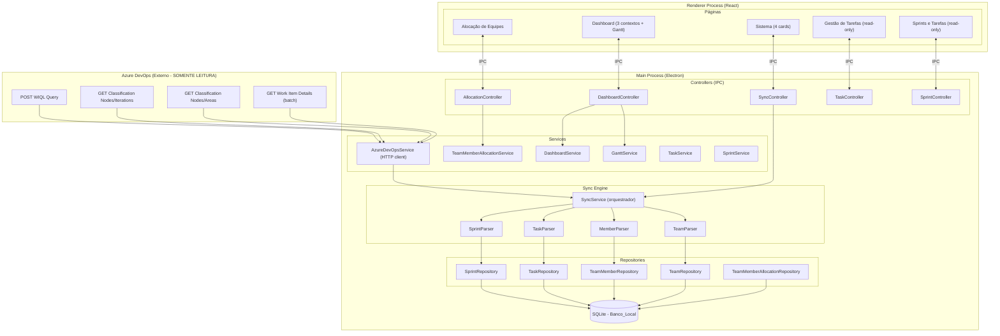
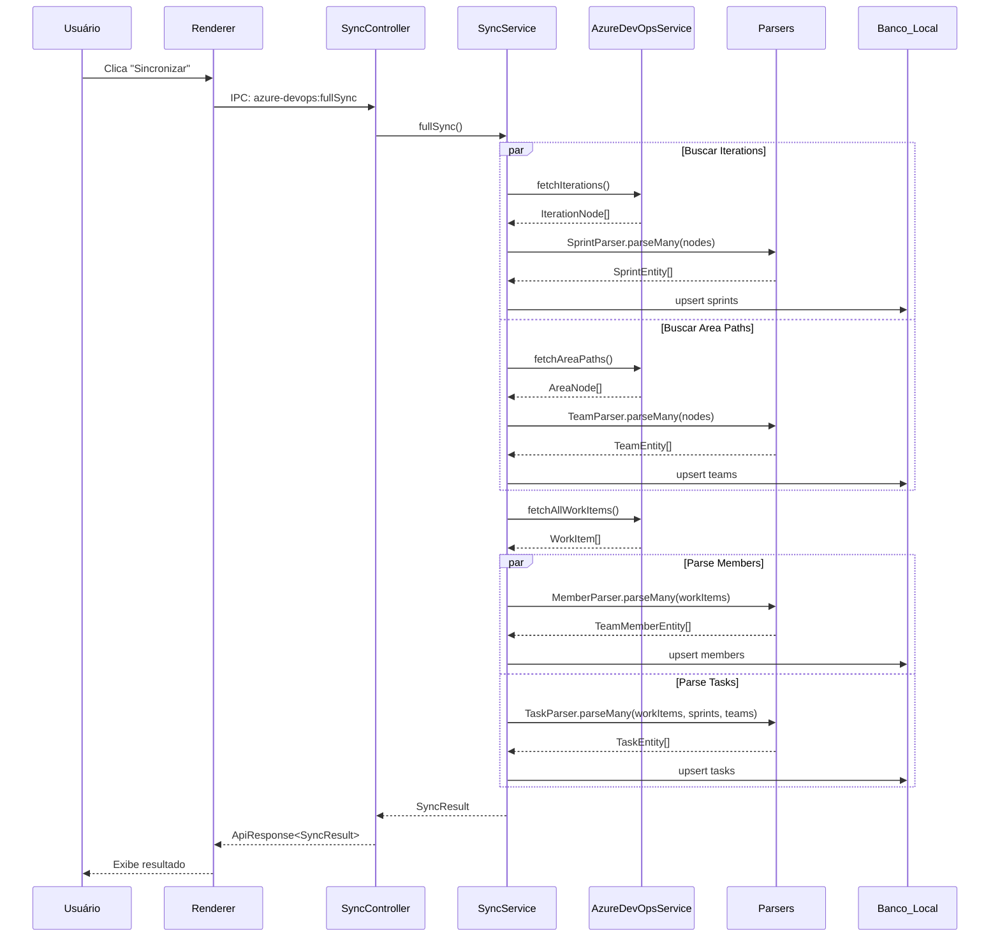
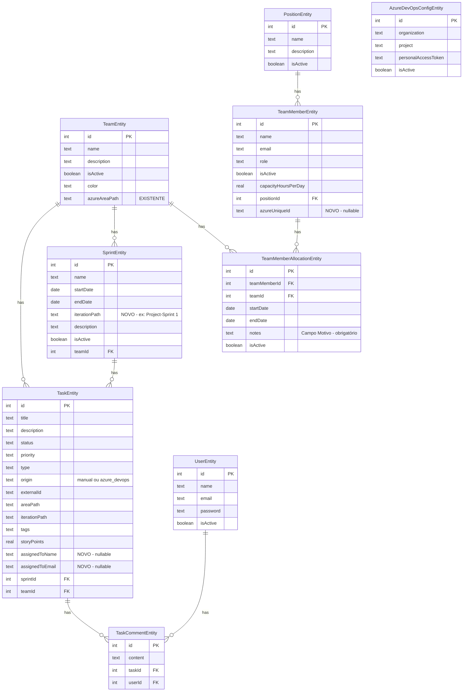
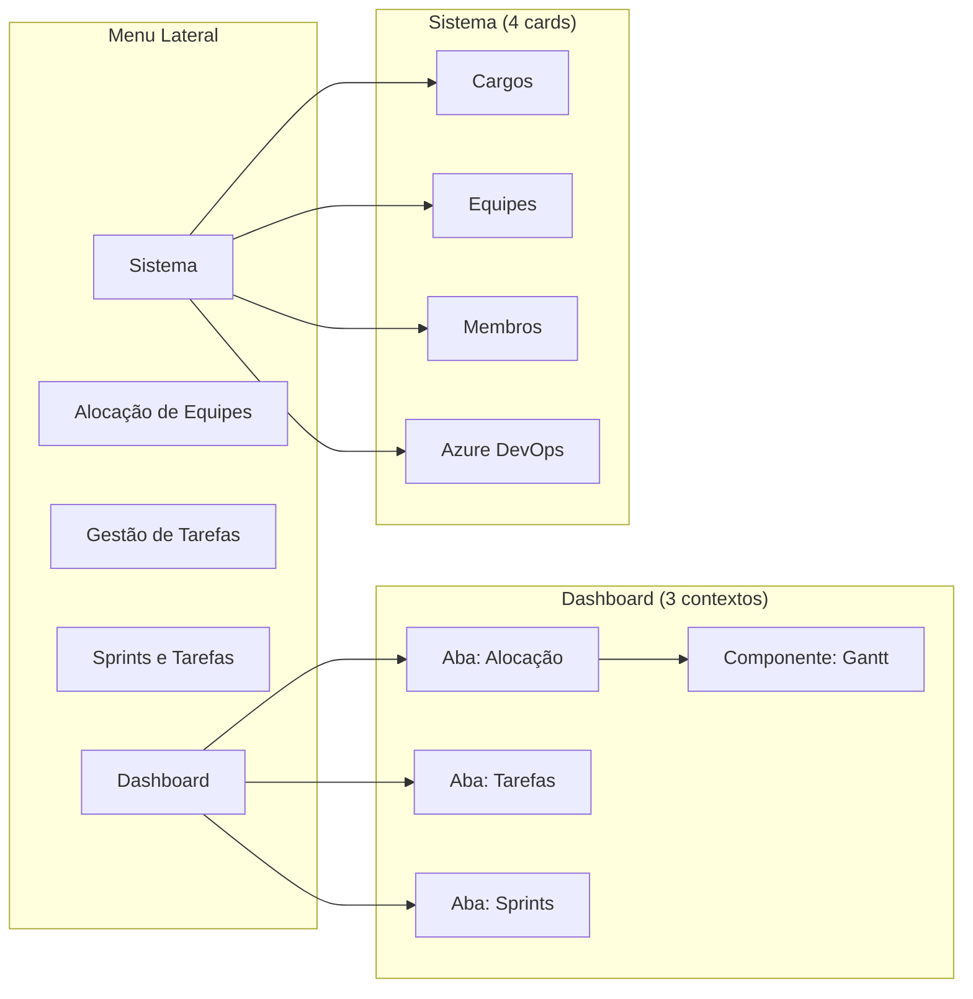

# Documento de Design — Reestruturação do Hub Azure DevOps

## Visão Geral

Este design descreve a reestruturação do sistema desktop (Electron + React + TypeORM/SQLite) para funcionar como um hub centralizado de planejamento de equipes integrado ao Azure DevOps. A mudança principal é a transição de um modelo de importação seletiva para um modelo de sincronização completa, onde sprints, tarefas e membros são sincronizados automaticamente do Azure DevOps e tratados como dados somente leitura no sistema local.

**Restrição Fundamental**: A integração com o Azure DevOps é exclusivamente de LEITURA. O Hub nunca envia, cria, atualiza ou exclui dados no Azure DevOps.

### Princípios de Design

1. **Fonte de verdade única**: Azure DevOps é a fonte de verdade para sprints, tarefas e membros. O Banco_Local é um cache sincronizado.
2. **Somente leitura para dados sincronizados**: Dados originados do Azure DevOps não podem ser editados localmente.
3. **Dados locais editáveis**: Alocações de equipe, cargos, configuração de equipes/membros e configuração do Azure DevOps são gerenciados localmente.
4. **Parsers isolados**: Cada tipo de entidade possui um parser dedicado para mapear dados da API para entidades locais.
5. **Dashboard centralizado**: Três contextos de dashboard (Alocação, Gestão de Tarefas, Sprints) com Gantt integrado.

## Arquitetura

### Diagrama de Arquitetura de Alto Nível



### Fluxo de Sincronização



## Componentes e Interfaces

### 1. Módulo de Parsers (`src/main/application/parsers/`)

Cada parser é uma função pura que converte dados da API do Azure DevOps para entidades locais. Parsers não fazem I/O — apenas transformação de dados.

#### SprintParser

```typescript
// src/main/application/parsers/sprint-parser.ts

interface AzureIterationNode {
  id: number;
  name: string;
  path: string;
  attributes?: {
    startDate?: string;
    finishDate?: string;
  };
  children?: AzureIterationNode[];
}

interface ParsedSprint {
  name: string;
  startDate: Date;
  endDate: Date;
  iterationPath: string;
}

function parseSprint(node: AzureIterationNode): ParsedSprint | null;
function parseSprintMany(nodes: AzureIterationNode[]): ParsedSprint[];
function flattenIterationTree(root: AzureIterationNode): AzureIterationNode[];
```

- Achata a árvore de iterações recursivamente
- Ignora nós sem `startDate` ou `finishDate` (iterações raiz sem datas)
- Mapeia `path` para `iterationPath` (ex: `\Project\Sprint 1`)

#### TeamParser

```typescript
// src/main/application/parsers/team-parser.ts

interface AzureAreaNode {
  id: number;
  name: string;
  path: string;
  children?: AzureAreaNode[];
}

interface ParsedTeam {
  name: string;
  azureAreaPath: string;
}

function parseTeam(node: AzureAreaNode): ParsedTeam;
function parseTeamMany(nodes: AzureAreaNode[]): ParsedTeam[];
function flattenAreaTree(root: AzureAreaNode): AzureAreaNode[];
```

- Achata a árvore de area paths recursivamente
- Mapeia `name` para `team.name` e `path` para `team.azureAreaPath`

#### MemberParser

```typescript
// src/main/application/parsers/member-parser.ts

interface AzureAssignedTo {
  displayName: string;
  uniqueName: string; // email
  id?: string; // azure unique id
}

interface ParsedMember {
  name: string;
  email: string;
  azureUniqueId?: string;
}

function parseMember(assignedTo: AzureAssignedTo): ParsedMember;
function parseMemberMany(assignedToList: AzureAssignedTo[]): ParsedMember[];
function deduplicateMembers(members: ParsedMember[]): ParsedMember[];
```

- Extrai `displayName`, `uniqueName` (email) e `id` (azureUniqueId)
- Deduplica por `email` (uniqueName)

#### TaskParser

```typescript
// src/main/application/parsers/task-parser.ts

interface AzureWorkItem {
  id: number;
  fields: {
    'System.Title': string;
    'System.Description'?: string;
    'System.WorkItemType': string;
    'System.State': string;
    'System.AreaPath'?: string;
    'System.IterationPath'?: string;
    'System.Tags'?: string;
    'Microsoft.VSTS.Scheduling.StoryPoints'?: number;
    'Microsoft.VSTS.Common.Priority'?: number;
    'System.AssignedTo'?: AzureAssignedTo;
  };
}

interface ParsedTask {
  title: string;
  description?: string;
  type: TaskType;
  status: TaskStatus;
  priority: TaskPriority;
  areaPath?: string;
  iterationPath?: string;
  tags?: string;
  storyPoints?: number;
  assignedToName?: string;
  assignedToEmail?: string;
  externalId: string;
  origin: 'azure_devops';
}

function parseTask(workItem: AzureWorkItem): ParsedTask;
function parseTaskMany(workItems: AzureWorkItem[]): ParsedTask[];
```

- Utiliza `mapWorkItemType()` e `mapWorkItemStateToTaskStatus()` existentes
- Extrai `assignedToName` e `assignedToEmail` do campo `System.AssignedTo`
- Define `origin: 'azure_devops'` e `externalId` como string do ID do work item

### 2. SyncService (`src/main/application/services/sync-service.ts`)

Orquestrador central da sincronização completa. Substitui o fluxo de importação seletiva.

```typescript
interface FullSyncResult {
  sprints: { created: number; updated: number; total: number };
  teams: { created: number; updated: number; total: number };
  members: { created: number; updated: number; total: number };
  tasks: { created: number; updated: number; total: number };
  errors: string[];
  syncedAt: Date;
}

class SyncService {
  constructor(
    private azureDevOpsService: AzureDevOpsService,
    private sprintRepository: SprintRepository,
    private teamRepository: TeamRepository,
    private teamMemberRepository: TeamMemberRepository,
    private taskRepository: TaskRepository,
  ) {}

  async fullSync(): Promise<FullSyncResult>;
  private async syncSprints(): Promise<SyncStepResult>;
  private async syncTeams(): Promise<SyncStepResult>;
  private async syncMembers(
    workItems: AzureWorkItem[],
  ): Promise<SyncStepResult>;
  private async syncTasks(
    workItems: AzureWorkItem[],
    sprints: SprintEntity[],
    teams: TeamEntity[],
  ): Promise<SyncStepResult>;
}
```

**Estratégia de upsert**:

- Sprints: match por `iterationPath` (campo novo). Se existe, atualiza; senão, cria.
- Teams: match por `azureAreaPath` (campo existente). Se existe, atualiza nome; senão, cria.
- Members: match por `email` (uniqueName). Se existe, atualiza `azureUniqueId`; senão, cria com role padrão `developer`.
- Tasks: match por `externalId` + `origin='azure_devops'`. Se existe, atualiza campos; senão, cria.

**Resolução de relacionamentos**:

- Task → Sprint: match por `iterationPath` da task com `iterationPath` da sprint
- Task → Team: match por `areaPath` da task com `azureAreaPath` da team (usa `resolveTeamByAreaPath` existente)

### 3. AzureDevOpsService (alterações)

O serviço existente recebe novos métodos e tem métodos deprecados:

```typescript
// Novos métodos
async fetchAreaPaths(): Promise<AzureAreaNode[]>;
async fetchAllWorkItems(): Promise<AzureWorkItem[]>;

// Métodos deprecados (manter para compatibilidade, marcar @deprecated)
// importWorkItems() — substituído por SyncService.fullSync()
// getReportData() — substituído por DashboardService usando Banco_Local
// getDashboardMetrics() — substituído por DashboardService expandido
```

`fetchAllWorkItems()` executa WIQL sem filtro de IDs específicos, buscando TODOS os work items do projeto. Respeita o limite de 200 IDs por batch na busca de detalhes.

### 4. TeamMemberAllocationService (alterações)

```typescript
interface CreateTeamMemberAllocationInput {
  teamMemberId: number;
  teamId: number;
  startDate: Date;
  endDate?: Date;
  notes: string; // obrigatório — campo "Motivo"
  // dedicationPercentage REMOVIDO DO SCHEMA
}

class TeamMemberAllocationService {
  // Validação alterada: unicidade entre TODAS as equipes
  async create(
    input: CreateTeamMemberAllocationInput,
  ): Promise<TeamMemberAllocation>;

  // Novo método: detectar conflitos alocação vs tarefas
  async detectAllocationConflicts(
    teamMemberId?: number,
  ): Promise<AllocationConflict[]>;

  // Novo método: validar unicidade cross-team
  private async validateCrossTeamUniqueness(
    teamMemberId: number,
    startDate: Date,
    endDate?: Date,
    excludeAllocationId?: number,
  ): Promise<void>;
}

interface AllocationConflict {
  memberId: number;
  memberName: string;
  allocatedTeamId: number;
  allocatedTeamName: string;
  taskTeamId: number;
  taskTeamName: string;
  taskTitle: string;
}
```

**Mudanças na validação de `create()`**:

1. Remove validação de `dedicationPercentage` e `getTotalDedication()`
2. Torna `notes` obrigatório (campo "Motivo")
3. Substitui `findOverlapping` (mesma equipe) por `validateCrossTeamUniqueness` (todas as equipes)

### 5. DashboardService (expansão)

```typescript
interface AllocationDashboard {
  activeAllocations: number;
  membersAllocated: number;
  membersWithoutAllocation: TeamMember[];
  allocationConflicts: AllocationConflict[];
  allocationsByTeam: { teamName: string; count: number }[];
}

interface TaskManagementDashboard {
  totalTasks: number;
  tasksByStatus: { status: string; count: number }[];
  tasksByType: { type: string; count: number }[];
  tasksByTeam: { teamName: string; count: number }[];
  unassignedTasks: number;
}

interface SprintDashboard {
  activeSprints: SprintSummary[];
  completedSprints: number;
  tasksBySprint: { sprintName: string; total: number; completed: number }[];
  velocity: { sprintName: string; storyPoints: number }[];
}

interface SprintSummary {
  id: number;
  name: string;
  startDate: Date;
  endDate: Date;
  totalTasks: number;
  completedTasks: number;
  totalStoryPoints: number;
}

class DashboardService {
  async getAllocationDashboard(): Promise<AllocationDashboard>;
  async getTaskManagementDashboard(): Promise<TaskManagementDashboard>;
  async getSprintDashboard(): Promise<SprintDashboard>;
  // getSummary() mantido para compatibilidade, mas delegando para os novos métodos
}
```

Todos os métodos do DashboardService utilizam exclusivamente dados do Banco_Local. Nenhuma chamada à API do Azure DevOps.

### 6. GanttService (integração ao Dashboard)

O GanttService existente é mantido sem alterações na lógica. A mudança é apenas no frontend: o componente Gantt é movido de uma página separada para dentro do Dashboard como componente integrado.

### 7. IPC Channels

#### Novos Channels

| Channel                                | Controller           | Descrição                      |
| -------------------------------------- | -------------------- | ------------------------------ |
| `azure-devops:fullSync`                | SyncController       | Sincronização completa         |
| `dashboard:getAllocationDashboard`     | DashboardController  | Dashboard de alocação          |
| `dashboard:getTaskManagementDashboard` | DashboardController  | Dashboard de tarefas           |
| `dashboard:getSprintDashboard`         | DashboardController  | Dashboard de sprints           |
| `allocation:detectConflicts`           | AllocationController | Detectar conflitos de alocação |

#### Channels Deprecados (remover)

| Channel                             | Motivo                                      |
| ----------------------------------- | ------------------------------------------- |
| `azure-devops:importWorkItems`      | Substituído por `fullSync`                  |
| `azure-devops:syncTask`             | Substituído por `fullSync`                  |
| `azure-devops:syncAllImportedTasks` | Substituído por `fullSync`                  |
| `azure-devops:getReportData`        | Dados vêm do Banco_Local via Dashboard      |
| `azure-devops:getDashboardMetrics`  | Substituído por novos channels de dashboard |
| `azure-devops:exportPdf`            | Integrado ao dashboard                      |

#### Channels Mantidos

| Channel                                         | Observação                                  |
| ----------------------------------------------- | ------------------------------------------- |
| `azure-devops:saveConfig`                       | Configuração local editável                 |
| `azure-devops:getConfig`                        | Leitura de configuração                     |
| `azure-devops:testConnection`                   | Teste de conectividade                      |
| `azure-devops:fetchWorkItems`                   | Pode ser mantido para preview antes do sync |
| `azure-devops:fetchIterations`                  | Pode ser mantido para preview               |
| `dashboard:getSummary`                          | Mantido para compatibilidade                |
| Todos os channels de `team-member-allocation:*` | Alocação é dado local editável              |
| Todos os channels de `position:*`               | Cargos são dados locais editáveis           |
| Todos os channels de `team:*`                   | Equipes são dados locais editáveis          |
| Todos os channels de `team-member:*`            | Membros são dados locais editáveis          |

## Modelos de Dados

### Migração Consolidada de Banco de Dados

Todas as migrações existentes (001 a 008) e a migração planejada (009) são consolidadas em um único arquivo `001_leadhelper_schema.sql` que cria o schema completo do zero. Os arquivos de migração antigos (002 a 008) devem ser removidos.

**Tabelas removidas**: `allocations`, `task_status_config`, `team_member_teams`
**Colunas removidas de `tasks`**: `estimation_points`, `estimation_hours`, `estimation_type`, `external_source`, `assignee_id`
**Colunas removidas de `team_member_allocations`**: `dedication_percentage`

Migração `001_leadhelper_schema.sql`:

```sql
-- Migration 001: LeadHelper - Schema Consolidado
-- Consolida todas as migrações anteriores (001-008) + campos novos (009)
-- Tabelas removidas: allocations, task_status_config, team_member_teams
-- Colunas removidas de tasks: estimation_points, estimation_hours, estimation_type, external_source, assignee_id
-- Colunas removidas de team_member_allocations: dedication_percentage

-- ============================================================
-- Tabela de controle de migrações
-- ============================================================
CREATE TABLE IF NOT EXISTS migrations (
    id INTEGER PRIMARY KEY AUTOINCREMENT,
    name TEXT NOT NULL UNIQUE,
    executed_at DATETIME DEFAULT CURRENT_TIMESTAMP
);

-- ============================================================
-- Cargos (positions)
-- ============================================================
CREATE TABLE IF NOT EXISTS positions (
    id INTEGER PRIMARY KEY AUTOINCREMENT,
    name TEXT NOT NULL,
    description TEXT,
    is_active INTEGER NOT NULL DEFAULT 1,
    created_at DATETIME NOT NULL DEFAULT CURRENT_TIMESTAMP,
    updated_at DATETIME NOT NULL DEFAULT CURRENT_TIMESTAMP
);

-- Dados padrão de cargos
INSERT INTO positions (name, description, is_active) VALUES
    ('Desenvolvedor', 'Desenvolvedor de software', 1),
    ('Tech Lead', 'Líder técnico', 1),
    ('QA', 'Analista de qualidade', 1),
    ('Scrum Master', 'Scrum Master', 1),
    ('Product Owner', 'Product Owner', 1),
    ('Designer', 'Designer de interface', 1),
    ('DevOps', 'Engenheiro DevOps', 1),
    ('Analista', 'Analista de sistemas', 1);

-- ============================================================
-- Usuários (users)
-- ============================================================
CREATE TABLE IF NOT EXISTS users (
    id INTEGER PRIMARY KEY AUTOINCREMENT,
    name TEXT NOT NULL,
    email TEXT NOT NULL UNIQUE,
    password TEXT NOT NULL,
    is_active INTEGER NOT NULL DEFAULT 1,
    created_at DATETIME NOT NULL DEFAULT CURRENT_TIMESTAMP,
    updated_at DATETIME NOT NULL DEFAULT CURRENT_TIMESTAMP
);

-- ============================================================
-- Equipes (teams)
-- ============================================================
CREATE TABLE IF NOT EXISTS teams (
    id INTEGER PRIMARY KEY AUTOINCREMENT,
    name TEXT NOT NULL,
    description TEXT,
    is_active INTEGER NOT NULL DEFAULT 1,
    color TEXT,
    azure_area_path TEXT,
    created_at DATETIME NOT NULL DEFAULT CURRENT_TIMESTAMP,
    updated_at DATETIME NOT NULL DEFAULT CURRENT_TIMESTAMP
);

-- ============================================================
-- Membros de equipe (team_members)
-- ============================================================
CREATE TABLE IF NOT EXISTS team_members (
    id INTEGER PRIMARY KEY AUTOINCREMENT,
    name TEXT NOT NULL,
    email TEXT,
    role TEXT,
    is_active INTEGER NOT NULL DEFAULT 1,
    capacity_hours_per_day REAL DEFAULT 8,
    position_id INTEGER,
    azure_unique_id TEXT,
    created_at DATETIME NOT NULL DEFAULT CURRENT_TIMESTAMP,
    updated_at DATETIME NOT NULL DEFAULT CURRENT_TIMESTAMP,
    FOREIGN KEY (position_id) REFERENCES positions(id)
);

CREATE INDEX IF NOT EXISTS idx_team_members_azure_unique_id ON team_members(azure_unique_id);

-- ============================================================
-- Alocações de membros em equipes (team_member_allocations)
-- SEM dedication_percentage — alocação dinâmica
-- ============================================================
CREATE TABLE IF NOT EXISTS team_member_allocations (
    id INTEGER PRIMARY KEY AUTOINCREMENT,
    team_member_id INTEGER NOT NULL,
    team_id INTEGER NOT NULL,
    start_date DATE NOT NULL,
    end_date DATE,
    notes TEXT,
    is_active INTEGER NOT NULL DEFAULT 1,
    created_at DATETIME NOT NULL DEFAULT CURRENT_TIMESTAMP,
    updated_at DATETIME NOT NULL DEFAULT CURRENT_TIMESTAMP,
    FOREIGN KEY (team_member_id) REFERENCES team_members(id),
    FOREIGN KEY (team_id) REFERENCES teams(id)
);

-- ============================================================
-- Sprints
-- ============================================================
CREATE TABLE IF NOT EXISTS sprints (
    id INTEGER PRIMARY KEY AUTOINCREMENT,
    name TEXT NOT NULL,
    start_date DATE,
    end_date DATE,
    description TEXT,
    is_active INTEGER NOT NULL DEFAULT 1,
    team_id INTEGER,
    iteration_path TEXT,
    created_at DATETIME NOT NULL DEFAULT CURRENT_TIMESTAMP,
    updated_at DATETIME NOT NULL DEFAULT CURRENT_TIMESTAMP,
    FOREIGN KEY (team_id) REFERENCES teams(id)
);

CREATE INDEX IF NOT EXISTS idx_sprints_iteration_path ON sprints(iteration_path);

-- ============================================================
-- Tarefas (tasks)
-- SEM estimation_points, estimation_hours, estimation_type, external_source, assignee_id
-- COM assigned_to_name, assigned_to_email (Azure DevOps)
-- ============================================================
CREATE TABLE IF NOT EXISTS tasks (
    id INTEGER PRIMARY KEY AUTOINCREMENT,
    title TEXT NOT NULL,
    description TEXT,
    status TEXT NOT NULL DEFAULT 'backlog',
    priority TEXT DEFAULT 'medium',
    type TEXT DEFAULT 'task',
    origin TEXT DEFAULT 'manual',
    external_id TEXT,
    area_path TEXT,
    iteration_path TEXT,
    tags TEXT,
    story_points REAL,
    assigned_to_name TEXT,
    assigned_to_email TEXT,
    sprint_id INTEGER,
    team_id INTEGER,
    created_at DATETIME NOT NULL DEFAULT CURRENT_TIMESTAMP,
    updated_at DATETIME NOT NULL DEFAULT CURRENT_TIMESTAMP,
    FOREIGN KEY (sprint_id) REFERENCES sprints(id),
    FOREIGN KEY (team_id) REFERENCES teams(id)
);

-- ============================================================
-- Comentários de tarefas (task_comments)
-- ============================================================
CREATE TABLE IF NOT EXISTS task_comments (
    id INTEGER PRIMARY KEY AUTOINCREMENT,
    content TEXT NOT NULL,
    task_id INTEGER NOT NULL,
    user_id INTEGER,
    created_at DATETIME NOT NULL DEFAULT CURRENT_TIMESTAMP,
    updated_at DATETIME NOT NULL DEFAULT CURRENT_TIMESTAMP,
    FOREIGN KEY (task_id) REFERENCES tasks(id) ON DELETE CASCADE,
    FOREIGN KEY (user_id) REFERENCES users(id)
);

-- ============================================================
-- Configuração do Azure DevOps
-- ============================================================
CREATE TABLE IF NOT EXISTS azure_devops_config (
    id INTEGER PRIMARY KEY AUTOINCREMENT,
    organization TEXT NOT NULL,
    project TEXT NOT NULL,
    personal_access_token TEXT NOT NULL,
    is_active INTEGER NOT NULL DEFAULT 1,
    created_at DATETIME NOT NULL DEFAULT CURRENT_TIMESTAMP,
    updated_at DATETIME NOT NULL DEFAULT CURRENT_TIMESTAMP
);

-- Registrar migração
INSERT INTO migrations (name) VALUES ('001_leadhelper_schema');
```

**Nota sobre migração consolidada**: Os arquivos de migração antigos (`002_*.sql` a `008_*.sql`) devem ser removidos do diretório de migrações. Apenas `001_leadhelper_schema.sql` permanece. O código de execução de migrações deve ser ajustado para reconhecer que o schema consolidado já inclui tudo.

**Nota sobre `dedicationPercentage`**: O campo `dedication_percentage` foi REMOVIDO do schema consolidado. A coluna não existe mais na tabela `team_member_allocations`. A entidade `TeamMemberAllocationEntity` deve ser atualizada para remover a propriedade `dedicationPercentage`.

### Diagrama ER (Entidades Afetadas)



**Tabelas removidas do schema** (não aparecem no diagrama):

- `allocations` — substituída pelo campo AssignedTo do Azure DevOps
- `task_status_config` — status de tarefas vem do Azure DevOps
- `team_member_teams` — substituída por `team_member_allocations`

### Estrutura de Navegação (Nova)



### Itens Removidos da Navegação

| Item Removido                          | Destino                                      |
| -------------------------------------- | -------------------------------------------- |
| Gantt (menu lateral)                   | Integrado ao Dashboard como componente       |
| Relatórios Azure DevOps (menu lateral) | Dados integrados aos dashboards por contexto |
| Alocação em Equipes (card Sistema)     | Tela dedicada "Alocação de Equipes" no menu  |
| Sprints (card Sistema)                 | Dados vêm do Azure DevOps via sync           |
| Tarefas (card Sistema)                 | Dados vêm do Azure DevOps via sync           |
| Alocações (card Sistema)               | Dados vêm do Azure DevOps via sync           |

### Frontend: Mudanças por Tela

#### Dashboard (`src/renderer/src/pages/Dashboard/`)

- Adicionar sistema de abas (tabs) para os 3 contextos: Alocação, Tarefas, Sprints
- Cada aba renderiza um componente de dashboard específico
- Componente Gantt integrado na aba de Alocação (ou como aba separada)
- Dados de relatórios Azure DevOps distribuídos nos dashboards por contexto
- Aviso quando configuração Azure DevOps não está definida

#### Gestão de Tarefas (`src/renderer/src/pages/TaskBoard/`)

- Remover botões/formulários de criação de tarefas
- Remover funcionalidade de alocação manual de membros em tarefas
- Exibir campo `assignedToName` como informação somente leitura
- Manter layout Kanban existente
- Adicionar indicador visual de "somente leitura" nos cards de tarefa
- Mensagem informativa ao tentar editar: "Este dado é gerenciado no Azure DevOps"

#### Sprints e Tarefas (`src/renderer/src/pages/SprintsTasks/`)

- Remover botões de criação/edição de sprints e tarefas
- Manter visualização de tarefas agrupadas por sprint
- Reutilizar componente de tabela da Gestão de Tarefas
- Adicionar filtro por sprint
- Indicador visual de somente leitura

#### Sistema (`src/renderer/src/pages/SystemSettings/`)

- Reduzir de 8 cards para 4: Cargos, Equipes, Membros, Azure DevOps
- Remover cards: Alocação em Equipes, Sprints, Tarefas, Alocações

#### Alocação de Equipes (`src/renderer/src/pages/TeamAllocation/`)

- Remover campo de percentual de dedicação do formulário
- Tornar campo "Motivo" (notes) obrigatório no formulário
- Adicionar exibição de alertas de conflito de alocação
- Mensagem de erro ao tentar alocar membro já alocado em outra equipe

#### panel.routes.tsx

- Remover rotas: `/panel/gantt`, `/panel/azure-devops-reports`
- Remover do `GENERAL_SECTION`: itens "Gantt" e "Relatórios Azure DevOps"
- Manter 5 itens no menu: Dashboard, Alocação de Equipes, Gestão de Tarefas, Sprints e Tarefas, Sistema

## Propriedades de Corretude

_Uma propriedade é uma característica ou comportamento que deve ser verdadeiro em todas as execuções válidas de um sistema — essencialmente, uma declaração formal sobre o que o sistema deve fazer. Propriedades servem como ponte entre especificações legíveis por humanos e garantias de corretude verificáveis por máquina._

### Property 1: Round-trip do Sprint Parser

_Para qualquer_ nó de iteração válido da API do Azure DevOps (com name, startDate, finishDate e path), parsear o nó para ParsedSprint, formatar de volta para o formato da API via pretty-printer de teste, e parsear novamente deve produzir um objeto equivalente ao primeiro parse.

**Validates: Requirements 10.1**

### Property 2: Round-trip do Team Parser

_Para qualquer_ nó de area path válido da API do Azure DevOps (com name e path), parsear o nó para ParsedTeam, formatar de volta para o formato da API via pretty-printer de teste, e parsear novamente deve produzir um objeto equivalente ao primeiro parse.

**Validates: Requirements 10.2**

### Property 3: Round-trip do Member Parser

_Para qualquer_ objeto AssignedTo válido da API do Azure DevOps (com displayName, uniqueName e id), parsear para ParsedMember, formatar de volta para o formato da API via pretty-printer de teste, e parsear novamente deve produzir um objeto equivalente ao primeiro parse.

**Validates: Requirements 10.3**

### Property 4: Round-trip do Task Parser

_Para qualquer_ work item válido da API do Azure DevOps (com todos os campos System._ e Microsoft.VSTS._), parsear para ParsedTask, formatar de volta para o formato da API via pretty-printer de teste, e parsear novamente deve produzir um objeto equivalente ao primeiro parse.

**Validates: Requirements 10.4**

### Property 5: Sincronização persiste todos os work items

_Para qualquer_ conjunto de work items retornados pela API do Azure DevOps (respeitando batches de 200 IDs), após a execução do fullSync, todos os work items devem existir no Banco_Local como TaskEntity com `origin='azure_devops'` e `externalId` correspondente ao ID original.

**Validates: Requirements 1.1**

### Property 6: Unicidade de alocação ativa entre equipes

_Para qualquer_ membro com uma alocação ativa na equipe A, tentar criar uma nova alocação ativa para o mesmo membro na equipe B (onde A ≠ B) com período sobreposto deve ser rejeitado com erro indicando a equipe onde o membro já está alocado.

**Validates: Requirements 9.2, 9.3**

### Property 7: Detecção de conflito alocação vs tarefas

_Para qualquer_ membro alocado na equipe X que possua tarefas com areaPath correspondente à equipe Y (onde X ≠ Y), o método `detectAllocationConflicts()` deve retornar um conflito contendo o membro, a equipe alocada e a equipe das tarefas.

**Validates: Requirements 9.1**

### Property 8: Campo Motivo obrigatório na alocação

_Para qualquer_ tentativa de criação de alocação onde o campo `notes` (Motivo) está vazio ou ausente, a operação deve ser rejeitada. Para qualquer tentativa com `notes` preenchido (e demais campos válidos), a operação deve ser aceita.

**Validates: Requirements 2.3**

### Property 9: Somente leitura para dados sincronizados

_Para qualquer_ TaskEntity com `origin='azure_devops'`, tentativas de atualização de campos originados do Azure DevOps (title, description, status, type, assignedToName, assignedToEmail) devem ser rejeitadas. Da mesma forma, SprintEntity com `iterationPath` preenchido não deve permitir edição de name, startDate ou endDate.

**Validates: Requirements 4.5, 11.2**

### Property 10: Dados locais são editáveis

_Para qualquer_ entidade gerenciada localmente (TeamMemberAllocationEntity, PositionEntity, TeamEntity, TeamMemberEntity), operações de criação, edição e exclusão devem ser permitidas e executadas com sucesso quando os dados de entrada são válidos.

**Validates: Requirements 11.5**

### Property 11: Filtragem de tarefas por sprint

_Para qualquer_ sprint existente no Banco_Local e qualquer conjunto de tarefas associadas a diferentes sprints, filtrar tarefas por uma sprint específica deve retornar apenas tarefas cujo `sprintId` corresponde à sprint selecionada, e o conjunto retornado deve ser um subconjunto do total de tarefas.

**Validates: Requirements 5.1, 5.4**

### Property 12: Dashboard reflete dados sincronizados

_Para qualquer_ conjunto de dados inseridos no Banco_Local via sincronização (tarefas, sprints, alocações), os métodos do DashboardService (`getAllocationDashboard`, `getTaskManagementDashboard`, `getSprintDashboard`) devem retornar métricas consistentes com os dados presentes no banco.

**Validates: Requirements 3.7**

## Tratamento de Erros

### Sincronização

| Cenário                            | Comportamento                                                                                                                |
| ---------------------------------- | ---------------------------------------------------------------------------------------------------------------------------- |
| Configuração Azure DevOps ausente  | `fullSync()` retorna erro descritivo. Frontend exibe aviso na tela de Dashboard e Sistema.                                   |
| Erro de conexão/rede               | `fullSync()` captura o erro, mantém dados existentes no Banco_Local, retorna `FullSyncResult` com array `errors` preenchido. |
| Erro em batch individual (200 IDs) | Registra erro no log, continua com próximos batches. Work items do batch com falha são listados em `errors`.                 |
| Iteration sem datas (nó raiz)      | SprintParser ignora o nó (retorna `null`). Não é erro.                                                                       |
| Work item sem AssignedTo           | TaskParser define `assignedToName` e `assignedToEmail` como `null`. Não cria membro.                                         |
| Work item com tipo desconhecido    | `mapWorkItemType()` retorna `'task'` como fallback (comportamento existente).                                                |

### Alocação de Equipes

| Cenário                           | Comportamento                                                                                                        |
| --------------------------------- | -------------------------------------------------------------------------------------------------------------------- |
| Membro já alocado em outra equipe | `create()` lança erro: "Membro já está alocado na equipe {nome}. Finalize a alocação atual antes de criar uma nova." |
| Campo Motivo (notes) vazio        | `create()` lança erro: "O campo Motivo é obrigatório para a alocação."                                               |
| Membro ou equipe inexistente      | `create()` lança erro descritivo (comportamento existente).                                                          |
| Data início após data fim         | `validateDates()` lança erro (comportamento existente).                                                              |

### Somente Leitura

| Cenário                                 | Comportamento                                                                                               |
| --------------------------------------- | ----------------------------------------------------------------------------------------------------------- |
| Tentativa de editar tarefa sincronizada | Service rejeita com erro: "Esta tarefa é gerenciada no Azure DevOps e não pode ser editada localmente."     |
| Tentativa de editar sprint sincronizada | Service rejeita com erro: "Esta sprint é gerenciada no Azure DevOps e não pode ser editada localmente."     |
| Tentativa de criar tarefa manual        | TaskService verifica se a funcionalidade está habilitada. Com a reestruturação, criação manual é bloqueada. |

### Dashboard

| Cenário                           | Comportamento                                                           |
| --------------------------------- | ----------------------------------------------------------------------- |
| Banco_Local vazio (sem sync)      | Dashboard exibe métricas zeradas com aviso para realizar sincronização. |
| Configuração Azure DevOps ausente | Dashboard exibe aviso informando necessidade de configuração.           |

## Estratégia de Testes

### Abordagem Dual: Testes Unitários + Testes Baseados em Propriedades

A estratégia de testes combina testes unitários (exemplos específicos e edge cases) com testes baseados em propriedades (validação universal com inputs gerados).

### Biblioteca de Property-Based Testing

- **Biblioteca**: [fast-check](https://github.com/dubzzz/fast-check) (TypeScript/JavaScript)
- **Configuração**: Mínimo de 100 iterações por teste de propriedade
- **Cada teste de propriedade DEVE referenciar a propriedade do design via comentário**
- **Formato do tag**: `Feature: azure-devops-hub-restructure, Property {number}: {property_text}`
- **Cada propriedade de corretude DEVE ser implementada por UM ÚNICO teste baseado em propriedade**

### Testes Baseados em Propriedades

| Propriedade                              | Módulo Testado                                             | Generators Necessários                                                  |
| ---------------------------------------- | ---------------------------------------------------------- | ----------------------------------------------------------------------- |
| Property 1: Round-trip Sprint Parser     | `sprint-parser.ts`                                         | `Arbitrary<AzureIterationNode>` com name, path, startDate, finishDate   |
| Property 2: Round-trip Team Parser       | `team-parser.ts`                                           | `Arbitrary<AzureAreaNode>` com name, path                               |
| Property 3: Round-trip Member Parser     | `member-parser.ts`                                         | `Arbitrary<AzureAssignedTo>` com displayName, uniqueName, id            |
| Property 4: Round-trip Task Parser       | `task-parser.ts`                                           | `Arbitrary<AzureWorkItem>` com todos os campos System.\*                |
| Property 5: Sync persiste work items     | `sync-service.ts`                                          | `Arbitrary<AzureWorkItem[]>` com IDs únicos                             |
| Property 6: Unicidade cross-team         | `team-member-allocation-service.ts`                        | `Arbitrary<{member, teamA, teamB, dates}>`                              |
| Property 7: Conflito alocação vs tarefas | `team-member-allocation-service.ts`                        | `Arbitrary<{member, allocation, tasks}>` com area paths diferentes      |
| Property 8: Motivo obrigatório           | `team-member-allocation-service.ts`                        | `Arbitrary<CreateTeamMemberAllocationInput>` com notes vazio/preenchido |
| Property 9: Somente leitura              | `task-service.ts`, `sprint-service.ts`                     | `Arbitrary<TaskEntity>` com origin='azure_devops'                       |
| Property 10: Dados locais editáveis      | `team-member-allocation-service.ts`, `position-service.ts` | `Arbitrary<CreateInput>` para cada entidade local                       |
| Property 11: Filtro por sprint           | `task-service.ts`                                          | `Arbitrary<{sprints, tasks}>` com associações variadas                  |
| Property 12: Dashboard reflete dados     | `dashboard-service.ts`                                     | `Arbitrary<{tasks, sprints, allocations}>`                              |

### Testes Unitários

| Área              | Exemplos e Edge Cases                                                            |
| ----------------- | -------------------------------------------------------------------------------- |
| SprintParser      | Nó sem datas (ignorado), árvore profunda (flatten), nó com datas válidas         |
| TeamParser        | Area path com múltiplos níveis, nó raiz                                          |
| MemberParser      | AssignedTo sem email, deduplicação por email                                     |
| TaskParser        | Work item sem AssignedTo, tipo desconhecido, estado desconhecido                 |
| SyncService       | Config ausente (erro), erro de rede (dados preservados), batch com falha parcial |
| AllocationService | Membro já alocado (erro com nome da equipe), notes vazio (erro), deactivate      |
| DashboardService  | Banco vazio (métricas zeradas), config ausente (aviso)                           |
| Navegação         | Menu lateral com 5 itens, Sistema com 4 cards                                    |
| Read-only         | Tentativa de editar tarefa azure_devops (erro), editar tarefa manual (sucesso)   |

### Pretty-Printers de Teste

Para os testes round-trip (Properties 1-4), são necessários pretty-printers que reconstroem o formato da API a partir das entidades parseadas. Estes pretty-printers existem APENAS no código de teste e NUNCA são usados em produção (o Hub é somente leitura).

```typescript
// test/helpers/pretty-printers.ts
function sprintToAzureFormat(parsed: ParsedSprint): AzureIterationNode;
function teamToAzureFormat(parsed: ParsedTeam): AzureAreaNode;
function memberToAzureFormat(parsed: ParsedMember): AzureAssignedTo;
function taskToAzureFormat(parsed: ParsedTask): AzureWorkItem;
```
