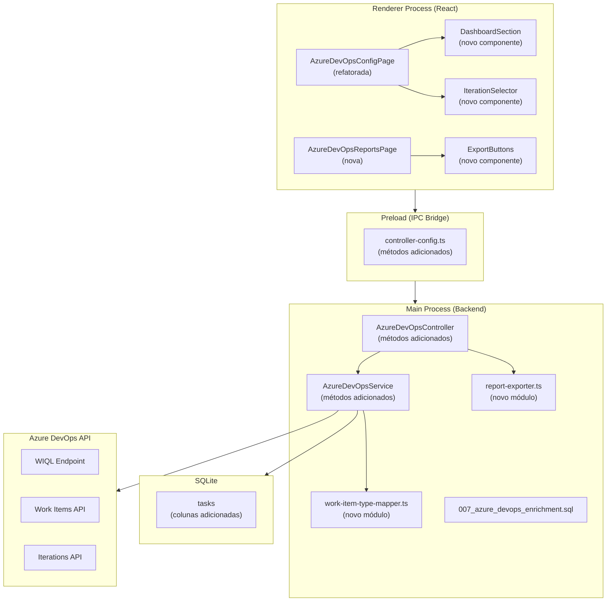
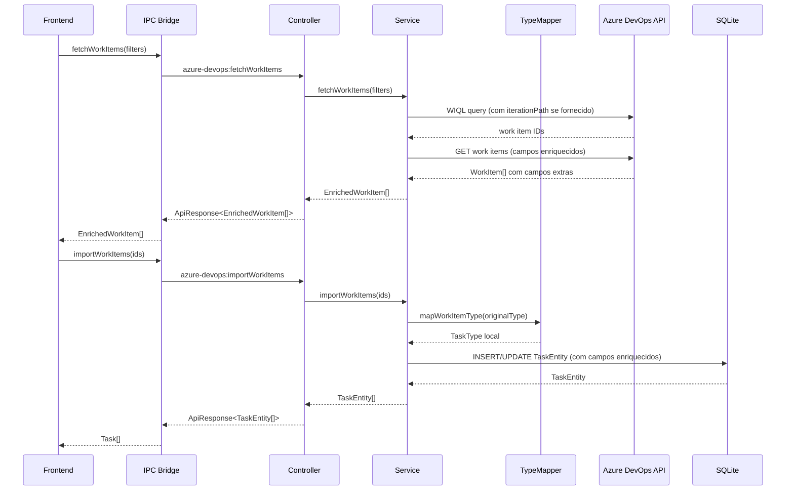
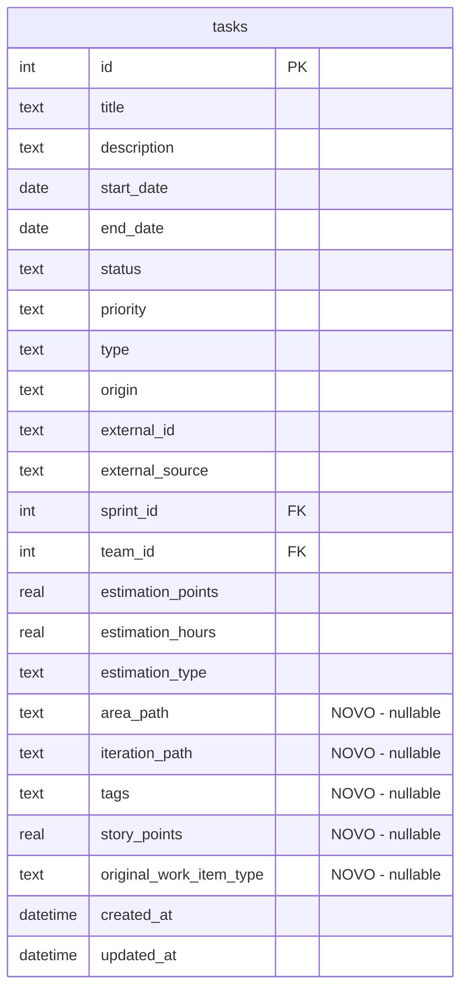

# Design — Azure DevOps Integration V2

## Visão Geral

Este design detalha as mudanças arquiteturais necessárias para evoluir a integração Azure DevOps do LeadHelper/TeamFlow. As melhorias abrangem 7 áreas: enriquecimento de dados na importação, mapeamento de tipos, filtro por iteration/sprint, tela de relatórios com gráficos, exportação CSV/PDF, dashboard de métricas e alinhamento de layout.

A abordagem mantém a arquitetura existente (Electron IPC via decorators, TypeORM + SQLite, React + MUI + styled-components) e estende os módulos atuais sem quebrar contratos existentes.

### Decisões de Design

1. **Enriquecimento in-place**: Os novos campos são adicionados diretamente na `TaskEntity` via migração 007, evitando tabelas auxiliares e JOINs desnecessários.
2. **Type Mapper como módulo puro**: O mapeamento de tipos é uma função pura sem estado, facilitando testes e reutilização.
3. **Relatórios via agregação no backend**: Os dados de relatório são agregados no backend (SQL) e enviados prontos ao frontend, evitando transferência de grandes volumes via IPC.
4. **Exportação no processo main**: CSV e PDF são gerados no processo main do Electron, que tem acesso ao `dialog.showSaveDialog` e ao filesystem.
5. **Recharts para gráficos**: Biblioteca leve, declarativa e compatível com React, sem dependências pesadas.
6. **jsPDF + autoTable para PDF**: Geração de PDF client-side-friendly, sem dependências nativas.

## Arquitetura

### Diagrama de Componentes



### Fluxo de Dados — Importação Enriquecida



## Componentes e Interfaces

### 1. Módulo Type Mapper (novo)

**Arquivo**: `src/main/application/services/work-item-type-mapper.ts`

```typescript
// Mapeamento de tipos Azure DevOps → TaskType local
const TYPE_MAP: Record<string, TaskType> = {
  feature: 'feature',
  bug: 'bug',
  task: 'task',
  improvement: 'improvement',
  'user story': 'feature',
  'product backlog item': 'task',
};

export function mapWorkItemType(azureType: string): TaskType {
  return TYPE_MAP[azureType.toLowerCase()] ?? 'task';
}
```

Função pura, sem estado, case-insensitive. Retorna `'task'` como fallback.

### 2. Interfaces Enriquecidas (shared types)

**Alterações em**: `src/shared/interfaces/config/index.types.ts`

```typescript
// WorkItem enriquecido (substitui o atual)
export interface WorkItem {
  id: number;
  title: string;
  type: string;
  state: string;
  description?: string;
  assignedTo?: string;
  createdDate: Date;
  changedDate: Date;
  // Campos enriquecidos (V2)
  projectName?: string;
  areaPath?: string;
  iterationPath?: string;
  tags?: string;
  storyPoints?: number;
  priority?: number;
  originalWorkItemType?: string;
}

// Filtros com iteration path
export interface WorkItemFilters {
  types?: string[];
  states?: string[];
  query?: string;
  iterationPath?: string; // novo
}

// Iteration tree node
export interface IterationNode {
  id: number;
  name: string;
  path: string;
  children: IterationNode[];
}

// Dados de relatório
export interface ReportData {
  totalItems: number;
  byType: Array<{ type: string; count: number }>;
  byStatus: Array<{ status: string; count: number }>;
  byAssignee: Array<{ assignee: string; count: number }>;
  byProject: Array<{ project: string; count: number }>;
  items: ReportItem[];
}

export interface ReportItem {
  id: number;
  title: string;
  type: string;
  originalType?: string;
  status: string;
  assignee?: string;
  project?: string;
  areaPath?: string;
  iterationPath?: string;
  tags?: string;
  storyPoints?: number;
  createdAt?: Date;
  updatedAt?: Date;
}

// Métricas do dashboard
export interface DashboardMetrics {
  totalImported: number;
  lastSyncDate?: Date;
  pendingSync: number;
  byStatus: Array<{ status: string; count: number }>;
}

// Período de relatório
export interface ReportPeriod {
  startDate: Date;
  endDate: Date;
}

// Resultado de exportação
export interface ExportResult {
  success: boolean;
  filePath?: string;
  error?: string;
}
```

### 3. Controller — Novos Métodos IPC

**Alterações em**: `src/main/application/controllers/azure-devops-controller.ts`

Novos métodos a adicionar:

| Método IPC                         | Parâmetros     | Retorno                         | Descrição                             |
| ---------------------------------- | -------------- | ------------------------------- | ------------------------------------- |
| `azure-devops:fetchIterations`     | —              | `ApiResponse<IterationNode[]>`  | Lista árvore de iterations do projeto |
| `azure-devops:getReportData`       | `ReportPeriod` | `ApiResponse<ReportData>`       | Dados agregados para relatórios       |
| `azure-devops:getDashboardMetrics` | —              | `ApiResponse<DashboardMetrics>` | Métricas resumidas do dashboard       |
| `azure-devops:exportCsv`           | `ReportPeriod` | `ApiResponse<ExportResult>`     | Exporta CSV com dialog nativo         |
| `azure-devops:exportPdf`           | `ReportPeriod` | `ApiResponse<ExportResult>`     | Exporta PDF com dialog nativo         |

### 4. Service — Métodos Adicionados

**Alterações em**: `src/main/application/services/azure-devops-service.ts`

- `fetchIterations()`: Consulta `_apis/wit/classificationnodes/Iterations?$depth=10` e retorna árvore de `IterationNode[]`
- `getReportData(period)`: Query SQL agregando tasks importadas por tipo, status, assignee e projeto no período
- `getDashboardMetrics()`: Query SQL para total importado, última sync, pendentes e distribuição por status
- Alteração em `fetchWorkItemDetails()`: Adicionar campos `System.AreaPath`, `System.IterationPath`, `System.Tags`, `Microsoft.VSTS.Scheduling.StoryPoints`, `Microsoft.VSTS.Common.Priority` na requisição
- Alteração em `fetchWorkItems()`: Adicionar cláusula WIQL `[System.IterationPath] UNDER '{iterationPath}'` quando filtro fornecido
- Alteração em `importWorkItems()`: Usar `mapWorkItemType()` e persistir campos enriquecidos
- Alteração em `syncTask()`: Atualizar campos enriquecidos na sincronização

### 5. Report Exporter (novo)

**Arquivo**: `src/main/application/services/report-exporter.ts`

```typescript
export class ReportExporter {
  async exportCsv(
    items: ReportItem[],
    period: ReportPeriod,
  ): Promise<ExportResult>;
  async exportPdf(
    items: ReportItem[],
    period: ReportPeriod,
  ): Promise<ExportResult>;
}
```

- CSV: Geração manual de string CSV com colunas definidas no requisito 5.2
- PDF: Usa `jsPDF` + `jspdf-autotable` para gerar tabela com título e período
- Ambos usam `dialog.showSaveDialog` do Electron para escolha de destino

### 6. Preload — Controller Config

**Alterações em**: `src/preload/controller-config.ts`

```typescript
azureDevOps: {
  prefix: 'azure-devops',
  methods: [
    'saveConfig',
    'getConfig',
    'testConnection',
    'fetchWorkItems',
    'importWorkItems',
    'syncTask',
    'syncAllImportedTasks',
    // Novos métodos V2
    'fetchIterations',
    'getReportData',
    'getDashboardMetrics',
    'exportCsv',
    'exportPdf',
  ] as const,
},
```

### 7. Frontend — Novos Componentes

#### 7.1 DashboardSection

Seção de cards de métricas exibida no topo da `AzureDevOpsConfigPage`, antes das abas. Usa `surface` background, `border-radius: 1rem`, `box-shadow: cards` do tema.

Cards:

- Total importado (número)
- Última sincronização (data/hora formatada)
- Pendentes de sincronização (número com badge)
- Distribuição por status (mini barras horizontais)

#### 7.2 IterationSelector

Componente `Autocomplete` (MUI) com árvore de iterations. Exibido na aba "Explorar Work Items". Carrega iterations via `fetchIterations` ao montar.

#### 7.3 AzureDevOpsReportsPage (nova página)

- Rota: `/panel/azure-devops-reports`
- Filtro de período: preset (7, 15, 30, 60, 90 dias) + personalizado (DatePicker)
- Gráfico de barras por tipo (Recharts `BarChart`)
- Gráfico de barras por status (Recharts `BarChart`)
- Tabela por assignee (MUI `Table` com `SortableTableCell`)
- Tabela por projeto (MUI `Table` com `SortableTableCell`)
- Botões "Exportar CSV" e "Exportar PDF"
- Usa `PageContainer`, tema dark Spotify-style

#### 7.4 Refatoração da AzureDevOpsConfigPage

- Adicionar `DashboardSection` antes das abas
- Adicionar `IterationSelector` na `ExploreTab`
- Usar `SortableTableCell` + `useTableSort` nas tabelas existentes
- Usar `Modal` com `variant="form"` para diálogos
- Adicionar empty state quando config não definida
- Loading skeletons consistentes com o sistema

### 8. Navegação

Adicionar item "Relatórios Azure DevOps" no menu lateral (`panel.routes.tsx`), na seção Geral, com ícone `AssessmentOutlinedIcon`.

## Modelos de Dados

### Migração 007 — Enriquecimento Azure DevOps

**Arquivo**: `src/main/infrastructure/database/migrations/007_azure_devops_enrichment.sql`

```sql
ALTER TABLE tasks ADD COLUMN area_path TEXT;
ALTER TABLE tasks ADD COLUMN iteration_path TEXT;
ALTER TABLE tasks ADD COLUMN tags TEXT;
ALTER TABLE tasks ADD COLUMN story_points REAL;
ALTER TABLE tasks ADD COLUMN original_work_item_type TEXT;
```

Todas as colunas são nullable para manter compatibilidade com tarefas manuais e importações anteriores.

### TaskEntity — Novos Campos

```typescript
// Adições à TaskEntity existente
@Column({ name: 'area_path', type: 'text', nullable: true })
areaPath?: string;

@Column({ name: 'iteration_path', type: 'text', nullable: true })
iterationPath?: string;

@Column({ name: 'tags', type: 'text', nullable: true })
tags?: string;

@Column({ name: 'story_points', type: 'real', nullable: true })
storyPoints?: number;

@Column({ name: 'original_work_item_type', type: 'text', nullable: true })
originalWorkItemType?: string;
```

### Task Interface (shared) — Novos Campos

```typescript
// Adições à interface Task existente
areaPath?: string;
iterationPath?: string;
tags?: string;
storyPoints?: number;
originalWorkItemType?: string;
```

### Diagrama ER — Campos Adicionados



## Propriedades de Corretude

_Uma propriedade é uma característica ou comportamento que deve ser verdadeiro em todas as execuções válidas de um sistema — essencialmente, uma declaração formal sobre o que o sistema deve fazer. Propriedades servem como ponte entre especificações legíveis por humanos e garantias de corretude verificáveis por máquina._

### Propriedade 1: Round-trip de enriquecimento na importação e sincronização

_Para qualquer_ WorkItem retornado pela API do Azure DevOps com campos enriquecidos (areaPath, iterationPath, tags, storyPoints, originalWorkItemType), após importação ou sincronização, a TaskEntity resultante deve conter os mesmos valores para esses campos. Quando um campo enriquecido é nulo/ausente na API, o valor armazenado deve ser nulo. Adicionalmente, o campo `type` da TaskEntity deve ser igual a `mapWorkItemType(workItem.type)` e o campo `originalWorkItemType` deve preservar o tipo original.

**Validates: Requirements 1.3, 1.5, 1.6, 2.3, 2.4**

### Propriedade 2: Requisição de detalhes inclui campos enriquecidos

_Para qualquer_ conjunto de IDs de work items, a URL construída por `fetchWorkItemDetails` deve conter os campos `System.AreaPath`, `System.IterationPath`, `System.Tags`, `Microsoft.VSTS.Scheduling.StoryPoints`, `Microsoft.VSTS.Common.Priority` e `System.WorkItemType` no parâmetro `fields`.

**Validates: Requirements 1.1**

### Propriedade 3: Tipo desconhecido resulta em fallback "task"

_Para qualquer_ string que não esteja nas chaves conhecidas do mapeamento de tipos (Feature, Bug, Task, Improvement, User Story, Product Backlog Item), `mapWorkItemType` deve retornar `'task'`.

**Validates: Requirements 2.2**

### Propriedade 4: Mapeamento de tipo é case-insensitive

_Para qualquer_ tipo conhecido do Azure DevOps em qualquer combinação de maiúsculas/minúsculas (ex: "FEATURE", "feature", "Feature", "fEaTuRe"), `mapWorkItemType` deve retornar o mesmo resultado que para a versão em minúsculas.

**Validates: Requirements 2.5**

### Propriedade 5: Cláusula WIQL de iteration path

_Para qualquer_ string não-vazia de iterationPath fornecida nos filtros, a consulta WIQL gerada por `fetchWorkItems` deve conter a cláusula `[System.IterationPath] UNDER '{iterationPath}'`. Quando iterationPath não é fornecido, a cláusula não deve estar presente.

**Validates: Requirements 3.2**

### Propriedade 6: Parsing da árvore de iterations

_Para qualquer_ resposta válida da API de classification nodes do Azure DevOps com estrutura de árvore aninhada, `fetchIterations` deve produzir uma lista de `IterationNode[]` onde cada nó preserva id, name e path, e os filhos são recursivamente mapeados.

**Validates: Requirements 3.4**

### Propriedade 7: Invariante de agrupamento nos relatórios

_Para qualquer_ conjunto de tarefas importadas e qualquer período, a soma das contagens em cada agrupamento (por tipo, por status, por assignee, por projeto) deve ser igual ao `totalItems` retornado por `getReportData`. Isto é, nenhum item é perdido ou duplicado na agregação.

**Validates: Requirements 4.3, 4.4, 4.5, 4.6, 4.7, 6.2, 6.5**

### Propriedade 8: CSV contém todas as colunas obrigatórias

_Para qualquer_ lista de `ReportItem[]`, o CSV gerado por `exportCsv` deve conter uma linha de cabeçalho com exatamente as colunas: ID, Título, Tipo, Tipo Original, Estado, Responsável, Projeto, Area Path, Iteration Path, Tags, Story Points, Data de Criação, Data de Atualização. Cada linha de dados deve ter o mesmo número de campos que o cabeçalho.

**Validates: Requirements 5.2**

### Propriedade 9: Dados exportados correspondem aos dados do relatório

_Para qualquer_ período, os itens retornados por `getReportData(period).items` devem ser idênticos (mesmos IDs, mesma ordem) aos itens usados por `exportCsv(period)` e `exportPdf(period)`.

**Validates: Requirements 5.7**

### Propriedade 10: Contagem de pendentes de sincronização

_Para qualquer_ conjunto de tarefas importadas do Azure DevOps, o valor `pendingSync` retornado por `getDashboardMetrics` deve ser igual ao número de tarefas cujo `changedDate` no Azure DevOps é posterior ao `updatedAt` local.

**Validates: Requirements 6.4**

## Tratamento de Erros

### Backend (Main Process)

| Cenário                                | Comportamento                                      | Código    |
| -------------------------------------- | -------------------------------------------------- | --------- |
| API Azure DevOps retorna 401           | Lança erro "Token de acesso inválido ou expirado"  | Existente |
| API Azure DevOps retorna 404           | Lança erro "Projeto não encontrado"                | Existente |
| Campo enriquecido nulo/ausente         | Armazena `null` sem erro                           | Novo      |
| Erro ao buscar iterations              | Retorna `[]` e loga erro                           | Novo      |
| Erro ao gerar CSV/PDF                  | Retorna `ExportResult { success: false, error }`   | Novo      |
| Usuário cancela dialog de salvamento   | Retorna `ExportResult { success: false }` sem erro | Novo      |
| Tipo de work item desconhecido         | Usa fallback `'task'`                              | Novo      |
| Período inválido (startDate > endDate) | Retorna dados vazios                               | Novo      |

### Frontend (Renderer Process)

| Cenário                  | Comportamento                                                      |
| ------------------------ | ------------------------------------------------------------------ |
| Erro na chamada IPC      | Exibe mensagem via `setError` no hook, com opção de retry          |
| Loading                  | Exibe skeleton/spinner consistente com o sistema                   |
| Config não definida      | Exibe empty state com botão de ação                                |
| Nenhum dado no relatório | Exibe mensagem "Nenhum dado encontrado para o período selecionado" |
| Exportação com sucesso   | Notificação toast com caminho do arquivo                           |

## Estratégia de Testes

### Abordagem Dual

A estratégia combina testes unitários (exemplos específicos) e testes baseados em propriedades (validação universal):

- **Testes unitários**: Casos específicos, edge cases, integrações com mocks
- **Testes de propriedade**: Propriedades universais validadas com inputs gerados aleatoriamente

### Biblioteca de Property-Based Testing

- **Biblioteca**: `fast-check` (compatível com TypeScript, integração nativa com Vitest/Jest)
- **Configuração**: Mínimo 100 iterações por teste de propriedade
- **Tag**: Cada teste deve referenciar a propriedade do design com comentário no formato:
  `// Feature: azure-devops-integration-v2, Property {N}: {título}`

### Testes Unitários

| Área                      | Escopo                                           | Tipo      |
| ------------------------- | ------------------------------------------------ | --------- |
| Type Mapper               | Mapeamentos conhecidos (2.1)                     | Exemplos  |
| Type Mapper               | Tipo desconhecido → "task"                       | Exemplo   |
| Service — fetchIterations | Erro da API retorna []                           | Edge case |
| Service — importWorkItems | WorkItem com campos nulos                        | Edge case |
| Report Exporter — CSV     | Geração com lista vazia                          | Edge case |
| Report Exporter — PDF     | Geração produz buffer válido                     | Exemplo   |
| Controller                | Cada novo método IPC retorna ApiResponse correto | Exemplos  |
| Frontend — empty state    | Config null renderiza empty state                | Exemplo   |
| Frontend — loading        | Estado loading renderiza skeleton                | Exemplo   |

### Testes de Propriedade

| Propriedade                    | Gerador                                                              | Iterações |
| ------------------------------ | -------------------------------------------------------------------- | --------- |
| P1: Round-trip enriquecimento  | Gerar WorkItems com campos enriquecidos aleatórios (incluindo nulls) | 100       |
| P2: Campos na URL              | Gerar arrays de IDs aleatórios                                       | 100       |
| P3: Fallback tipo desconhecido | Gerar strings aleatórias excluindo tipos conhecidos                  | 100       |
| P4: Case-insensitive           | Gerar variações de casing dos tipos conhecidos                       | 100       |
| P5: WIQL iteration clause      | Gerar strings de iteration path aleatórias + undefined               | 100       |
| P6: Parsing árvore iterations  | Gerar árvores JSON aninhadas aleatórias                              | 100       |
| P7: Invariante agrupamento     | Gerar listas de tasks com tipos/status/assignees aleatórios          | 100       |
| P8: CSV colunas                | Gerar listas de ReportItem com campos aleatórios                     | 100       |
| P9: Export = Report            | Gerar períodos aleatórios com conjunto fixo de tasks                 | 100       |
| P10: Pending sync count        | Gerar tasks com changedDate/updatedAt aleatórios                     | 100       |

### Cada propriedade DEVE ser implementada por UM ÚNICO teste de propriedade

Cada teste de propriedade deve ser anotado com:

```typescript
// Feature: azure-devops-integration-v2, Property 1: Round-trip de enriquecimento na importação e sincronização
```
