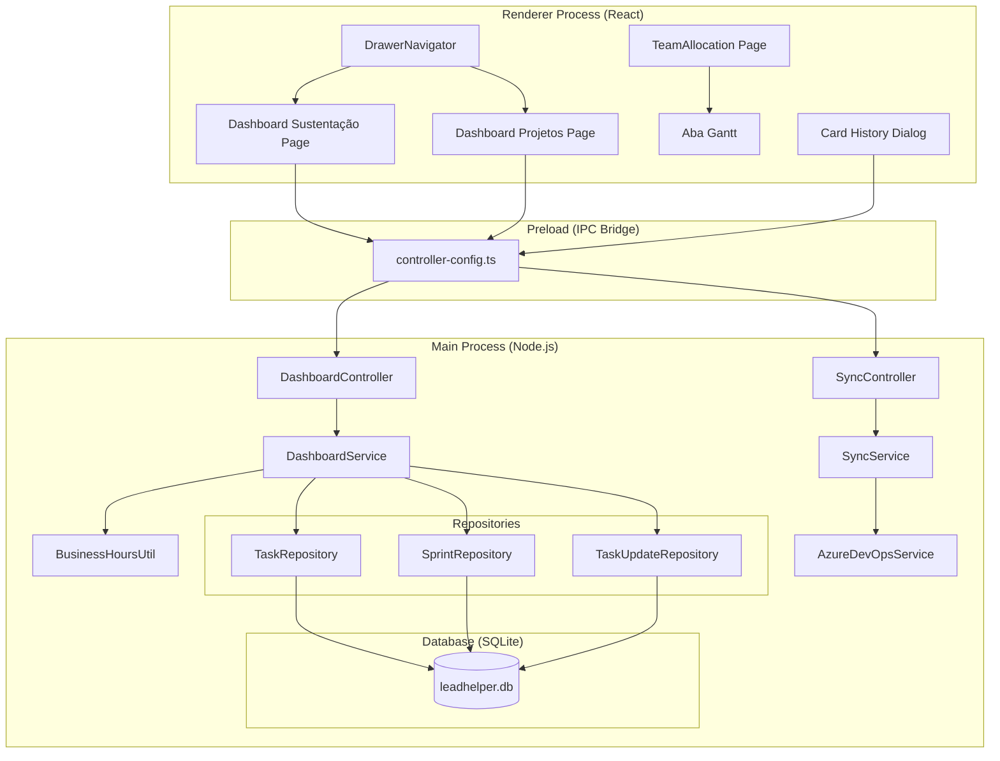
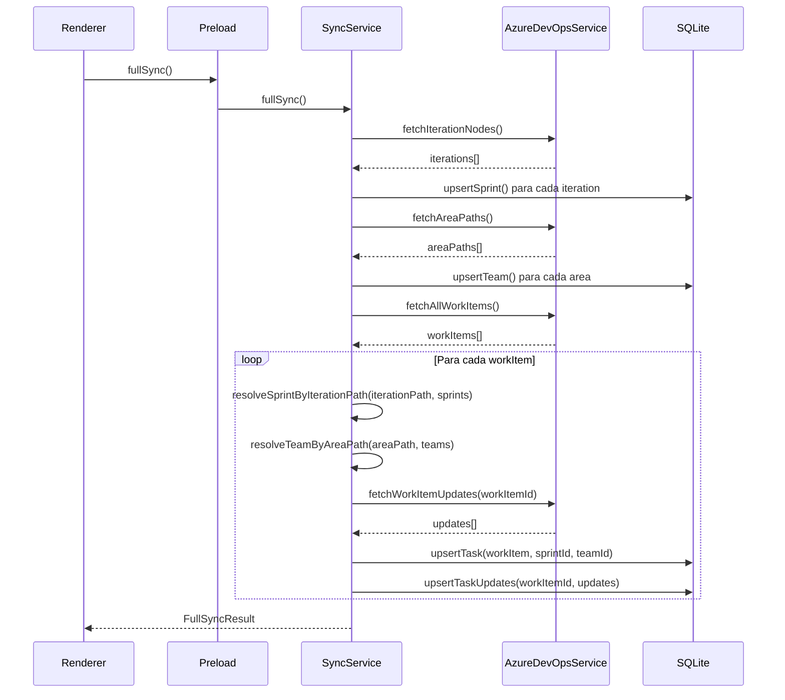

# Documento de Design — Reestruturação do LeadHelper

## Visão Geral

Este documento descreve o design técnico para a reestruturação do LeadHelper, uma aplicação Electron (electron-vite) com React, TypeScript, MUI, Redux e SQLite (better-sqlite3/TypeORM). A reestruturação abrange seis áreas principais:

1. **Correção da sincronização de sprints** — Ajustar o `SyncService` para resolver corretamente o `sprint_id` de cada work item usando `Iteration_Path` hierárquico.
2. **Dashboard de Sustentação** — Novo dashboard filtrado por `Area_Path` "Tribo SEIF\Sustentação" com cálculo de SLA em horas úteis.
3. **Dashboard de Projetos** — Novo dashboard filtrado por `Area_Path` "Tribo SEIF\Projetos" com visão de sprint atual e alertas de estagnação.
4. **Histórico de atualizações de cards** — Sincronizar e exibir o histórico de alterações de cada work item via API de Updates do Azure DevOps.
5. **Reestruturação da navegação** — Consolidar em dois dashboards, adicionar aba Gantt à Tela de Alocação, remover tela de Relatórios.
6. **Cálculo de horas úteis para SLA** — Módulo utilitário para cálculo de horas úteis (08h00–12h00, 13h30–17h30, seg–sex).

### Decisões de Design

- O cálculo de horas úteis será implementado como um módulo utilitário puro (`business-hours.ts`) sem dependências externas, facilitando testes unitários e property-based.
- O histórico de atualizações será armazenado em uma nova tabela `task_updates` no SQLite, sincronizada junto com os work items.
- Os dashboards de Sustentação e Projetos substituirão o dashboard unificado atual (`TeamDashboardPage`), reutilizando o `DashboardService` existente com métodos já parcialmente implementados (`getSustentacaoItems`, `getProjetosItems`).
- A aba Gantt será integrada à `TeamAllocationPage` existente usando o `GanttService` já implementado.
- O `report-exporter.ts` será mantido internamente conforme requisito 7.3.

## Arquitetura

A aplicação segue a arquitetura Electron com separação em três processos:



### Fluxo de Dados da Sincronização (Corrigido)



## Componentes e Interfaces

### 1. Módulo de Horas Úteis (`business-hours.ts`)

Módulo utilitário puro localizado em `src/main/infrastructure/utils/business-hours.ts`.

```typescript
// Constantes
const MORNING_START = { hour: 8, minute: 0 };   // 08:00
const MORNING_END = { hour: 12, minute: 0 };     // 12:00
const AFTERNOON_START = { hour: 13, minute: 30 }; // 13:30
const AFTERNOON_END = { hour: 17, minute: 30 };   // 17:30
const HOURS_PER_DAY = 8; // 4h manhã + 4h tarde

// Funções exportadas
function calculateBusinessHours(start: Date, end: Date): number;
function addBusinessHours(start: Date, hours: number): Date;
function isBusinessHour(date: Date): boolean;
function nextBusinessHourStart(date: Date): Date;
function isBusinessDay(date: Date): boolean;
```

### 2. SyncService — Correção de Sprint Resolution

O método `resolveSprintByIterationPath` já existe e implementa a lógica correta (match exato + hierárquico por caminho mais longo). A correção principal é garantir que:
- O `upsertTask` sempre chame `resolveSprintByIterationPath` com a lista atualizada de sprints.
- Sprints sejam sincronizadas ANTES dos work items.
- Logs de aviso sejam emitidos para `Iteration_Path` não resolvidos.

### 3. SyncService — Histórico de Atualizações

Novo método no `AzureDevOpsService`:

```typescript
async fetchWorkItemUpdates(workItemId: number): Promise<WorkItemUpdate[]>;
```

Novo método no `SyncService`:

```typescript
private async syncTaskUpdates(externalId: string, workItemId: number): Promise<void>;
```

### 4. Dashboard Sustentação Page

Nova página React em `src/renderer/src/pages/DashboardSustentacao/index.tsx`:
- Filtra cards por `Area_Path` começando com "Tribo SEIF\Sustentação"
- Exibe membros da equipe com cards em andamento
- Calcula tempo decorrido em horas úteis usando `BusinessHoursUtil`
- Exibe indicadores de SLA (violado, alerta 80%)
- Exibe dias sem atualização por card

### 5. Dashboard Projetos Page

Nova página React em `src/renderer/src/pages/DashboardProjetos/index.tsx`:
- Filtra cards por `Area_Path` começando com "Tribo SEIF\Projetos"
- Identifica sprint atual por datas
- Agrupa cards por status
- Exibe alertas de itens pendentes/estagnados quando faltam ≤5 dias úteis
- Exibe resumo quantitativo da sprint

### 6. Card History Dialog

Componente compartilhado em `src/renderer/src/components/CardHistoryDialog/index.tsx`:
- Modal/Dialog que exibe o histórico de atualizações de um card
- Ordem cronológica decrescente
- Mostra: data, campo alterado, valor anterior, valor novo

### 7. Aba Gantt na Tela de Alocação

Modificação da `TeamAllocationPage` existente para incluir duas abas MUI (`Tabs`):
- Aba "Gestão de Alocações" — conteúdo atual
- Aba "Gráfico Gantt" — componente Gantt usando `GanttService` existente

### 8. Navegação Reestruturada

Modificação do `panel.routes.tsx`:
- Substituir entrada "Dashboard" por "Dashboard Sustentação" e "Dashboard Projetos"
- Remover entrada "Relatórios"
- Remover abas antigas do dashboard (Visão Geral, Performance, Alertas)
- Redirecionar rota padrão para Dashboard Sustentação
- Redirecionar `/panel/reports` para dashboard padrão

## Modelos de Dados

### Entidade Existente: `TaskEntity` (sem alterações)

A entidade `tasks` já possui os campos necessários: `areaPath`, `iterationPath`, `sprintId`, `priority`, `status`, `assignedToName`, `assignedToEmail`.

### Nova Entidade: `TaskUpdateEntity`

```typescript
@Entity('task_updates')
export class TaskUpdateEntity {
  @PrimaryGeneratedColumn()
  id!: number;

  @Column({ name: 'task_id' })
  taskId!: number;

  @ManyToOne('TaskEntity')
  @JoinColumn({ name: 'task_id' })
  task?: TaskEntity;

  @Column({ name: 'external_work_item_id', type: 'integer' })
  externalWorkItemId!: number;

  @Column({ name: 'revision', type: 'integer' })
  revision!: number;

  @Column({ name: 'changed_date', type: 'datetime' })
  changedDate!: Date;

  @Column({ name: 'changed_by', type: 'text', nullable: true })
  changedBy?: string;

  @Column({ name: 'field_name', type: 'text' })
  fieldName!: string;

  @Column({ name: 'old_value', type: 'text', nullable: true })
  oldValue?: string;

  @Column({ name: 'new_value', type: 'text', nullable: true })
  newValue?: string;
}
```

### Nova Interface: `WorkItemUpdate`

```typescript
export interface WorkItemUpdate {
  revision: number;
  changedDate: Date;
  changedBy?: string;
  fields: {
    fieldName: string;
    oldValue?: string;
    newValue?: string;
  }[];
}
```

### Interfaces de Dashboard Existentes (reutilizadas)

As interfaces `SustentacaoItem`, `ProjetosItem`, `SustentacaoOptions` já existem em `index.types.ts` e serão reutilizadas. Será adicionado o campo de SLA:

```typescript
// Extensão de SustentacaoItem
export interface SustentacaoItemWithSLA extends SustentacaoItem {
  businessHoursElapsed: number;  // horas úteis decorridas
  slaLimit: number;              // limite SLA em horas úteis
  slaPercentage: number;         // % do SLA consumido
  slaViolated: boolean;          // SLA ultrapassado
  slaWarning: boolean;           // ≥80% do SLA
}
```

### Mapeamento de SLA por Prioridade

```typescript
export const SLA_LIMITS: Record<TaskPriority, number> = {
  critical: 4,   // 4 horas úteis
  high: 8,       // 8 horas úteis (1 dia útil)
  medium: 24,    // 24 horas úteis (3 dias úteis)
  low: 40,       // 40 horas úteis (5 dias úteis)
};
```

## Propriedades de Corretude

*Uma propriedade é uma característica ou comportamento que deve ser verdadeiro em todas as execuções válidas de um sistema — essencialmente, uma declaração formal sobre o que o sistema deve fazer. Propriedades servem como ponte entre especificações legíveis por humanos e garantias de corretude verificáveis por máquina.*

### Propriedade 1: Resolução de Sprint por Iteration Path

*Para qualquer* work item com um `iterationPath` e *qualquer* conjunto de sprints locais com `iterationPath` definido, `resolveSprintByIterationPath` deve retornar a sprint cujo `iterationPath` é o prefixo mais longo (mais específico) que corresponde ao `iterationPath` do work item. Se nenhuma sprint corresponder, deve retornar `null`.

**Valida: Requisitos 1.1, 1.2, 1.3, 1.4**

### Propriedade 2: Resolução de Time por Area Path

*Para qualquer* work item com um `areaPath` e *qualquer* conjunto de times locais com `azureAreaPath` definido, `resolveTeamByAreaPath` deve retornar o time cujo `azureAreaPath` é o prefixo mais longo que corresponde ao `areaPath` do work item. Se nenhum time corresponder, deve retornar `null`.

**Valida: Requisitos 1.6**

### Propriedade 3: Filtragem de Cards por Area Path

*Para qualquer* conjunto de cards e *qualquer* prefixo de `areaPath`, a função de filtragem deve retornar exatamente os cards cujo `areaPath` começa com o prefixo especificado, e nenhum card cujo `areaPath` não comece com esse prefixo.

**Valida: Requisitos 2.1, 3.1**

### Propriedade 4: Cálculo de Horas Úteis

*Para quaisquer* duas datas `start` e `end` onde `start <= end`, `calculateBusinessHours(start, end)` deve retornar um valor que conta exclusivamente o tempo dentro dos intervalos 08h00–12h00 e 13h30–17h30 em dias de segunda a sexta-feira, excluindo fins de semana e o intervalo de almoço. O resultado para um dia útil completo deve ser exatamente 8 horas.

**Valida: Requisitos 2.5, 4.4, 4.5, 8.1, 8.2, 8.3, 8.4, 8.5**

### Propriedade 5: Round-trip de Horas Úteis

*Para qualquer* data `start` e *qualquer* número positivo de horas úteis `h`, `calculateBusinessHours(start, addBusinessHours(start, h))` deve ser igual a `h`. Ou seja, adicionar `h` horas úteis a uma data e depois calcular as horas úteis entre as duas datas deve retornar `h`.

**Valida: Requisitos 8.6**

### Propriedade 6: Determinação de Status de SLA

*Para qualquer* card com prioridade `p` e tempo decorrido em horas úteis `elapsed`, o status de SLA deve ser: `violated` se `elapsed > SLA_LIMITS[p]`, `warning` se `elapsed >= 0.8 * SLA_LIMITS[p]`, e `normal` caso contrário. Essas três condições são mutuamente exclusivas e exaustivas.

**Valida: Requisitos 2.6, 2.7, 2.8**

### Propriedade 7: Identificação da Sprint Atual

*Para qualquer* conjunto de sprints e *qualquer* data de referência, a sprint atual é aquela cuja `startDate <= referenceDate` e `endDate >= referenceDate`. Se múltiplas sprints satisfazem a condição para um mesmo time, a mais recente (por `startDate`) deve ser selecionada. Se nenhuma satisfaz, o resultado deve ser `null`.

**Valida: Requisitos 3.2**

### Propriedade 8: Invariante do Resumo Quantitativo da Sprint

*Para qualquer* sprint com um conjunto de cards, o resumo quantitativo deve satisfazer: `total = pending + inProgress + completed + cancelled`, e `percentualConclusao = (completed / total) * 100` (ou 0 se total = 0). A soma das contagens por status deve ser igual ao total.

**Valida: Requisitos 3.3, 3.6**

### Propriedade 9: Ordenação do Histórico de Atualizações

*Para qualquer* card com histórico de atualizações, ao exibir o histórico, as entradas devem estar ordenadas por `changedDate` em ordem decrescente (mais recente primeiro). Para quaisquer dois registros adjacentes na lista, o primeiro deve ter `changedDate` maior ou igual ao segundo.

**Valida: Requisitos 4.1**

### Propriedade 10: Round-trip de Armazenamento de Histórico

*Para qualquer* conjunto de atualizações de um work item, armazenar no banco e depois recuperar deve produzir registros equivalentes (mesmos campos: `changedDate`, `changedBy`, `fieldName`, `oldValue`, `newValue`).

**Valida: Requisitos 4.3**

### Propriedade 11: Dados do Gantt Refletem Alocações Filtradas

*Para qualquer* conjunto de alocações e *qualquer* filtro (equipe, período), os itens do Gantt devem conter exatamente as alocações que satisfazem o filtro. Cada item deve ter `start` e `end` correspondentes à alocação original (usando 31/12/2099 para alocações sem data de fim).

**Valida: Requisitos 6.4, 6.5, 6.6, 6.7**

## Tratamento de Erros

### Sincronização

- **Falha em card individual**: O `SyncService` deve capturar exceções por work item, registrar no log e continuar. O `FullSyncResult` reporta o total de falhas (Req. 1.7).
- **Falha na consulta de histórico**: Se `fetchWorkItemUpdates` falhar para um work item, o histórico anterior é mantido sem alterações (Req. 4.6).
- **Iteration_Path não resolvido**: Log de aviso com o path não encontrado, `sprint_id` permanece `null` (Req. 1.4).

### Dashboard

- **Sem sprint atual**: Dashboard de Projetos exibe mensagem informativa quando nenhuma sprint está ativa.
- **Sem cards**: Dashboards exibem estado vazio com mensagem orientativa.
- **Erro de cálculo de SLA**: Se a data de início do card for inválida, o SLA é marcado como "indeterminado".

### Navegação

- **Rota inexistente**: Qualquer rota não mapeada redireciona para o Dashboard Sustentação (Req. 5.4, 7.4).

## Estratégia de Testes

### Abordagem Dual

A estratégia combina testes unitários e testes baseados em propriedades (property-based testing) para cobertura abrangente:

- **Testes unitários**: Exemplos específicos, edge cases, cenários de erro e integração entre componentes.
- **Testes de propriedade**: Propriedades universais verificadas com entradas geradas aleatoriamente.

### Biblioteca de Property-Based Testing

- **Biblioteca**: `fast-check` (já presente no `node_modules` do projeto)
- **Framework de teste**: `vitest` (já configurado em `vitest.config.ts`)
- **Iterações mínimas**: 100 por teste de propriedade
- **Formato de tag**: `Feature: leadhelper-restructure, Property {number}: {título}`

### Testes de Propriedade (Property-Based)

Cada propriedade de corretude será implementada por um ÚNICO teste de propriedade:

1. **Propriedade 1** — Gerar iteration paths aleatórios e conjuntos de sprints, verificar resolução correta.
2. **Propriedade 2** — Gerar area paths aleatórios e conjuntos de times, verificar resolução correta.
3. **Propriedade 3** — Gerar cards com area paths variados e prefixos, verificar filtragem.
4. **Propriedade 4** — Gerar pares de datas aleatórios, verificar cálculo de horas úteis contra implementação de referência.
5. **Propriedade 5** — Gerar datas e horas aleatórias, verificar round-trip `calculateBusinessHours(start, addBusinessHours(start, h)) === h`.
6. **Propriedade 6** — Gerar prioridades e tempos decorridos aleatórios, verificar classificação de SLA.
7. **Propriedade 7** — Gerar conjuntos de sprints e datas de referência, verificar identificação da sprint atual.
8. **Propriedade 8** — Gerar conjuntos de cards com status variados, verificar invariante do resumo.
9. **Propriedade 9** — Gerar listas de atualizações com datas aleatórias, verificar ordenação decrescente.
10. **Propriedade 10** — Gerar atualizações aleatórias, armazenar e recuperar, verificar equivalência.
11. **Propriedade 11** — Gerar alocações e filtros aleatórios, verificar correspondência dos itens Gantt.

### Testes Unitários

Testes unitários focados em:

- **Exemplos específicos**: Cenários concretos de SLA (card crítico com 3h = normal, 3.5h = warning, 5h = violated).
- **Edge cases**: Datas no fim de semana, horário de almoço, meia-noite, virada de ano.
- **Navegação**: Verificar que rotas corretas existem e que `/panel/reports` redireciona.
- **Integração**: Verificar que `SyncService.fullSync()` chama os métodos na ordem correta (sprints → teams → members → tasks).
- **Erro**: Verificar que falha em um card não interrompe a sincronização.

### Organização dos Testes

```
src/main/application/services/__tests__/
  business-hours.test.ts          # Propriedades 4, 5
  business-hours.property.test.ts # PBT para horas úteis
  sync-service.test.ts            # Propriedades 1, 2
  sync-service.property.test.ts   # PBT para resolução de sprint/time
  dashboard-service.test.ts       # Propriedades 3, 6, 7, 8
  dashboard-service.property.test.ts # PBT para dashboard
  task-update.test.ts             # Propriedades 9, 10
  gantt-service.property.test.ts  # Propriedade 11
```
